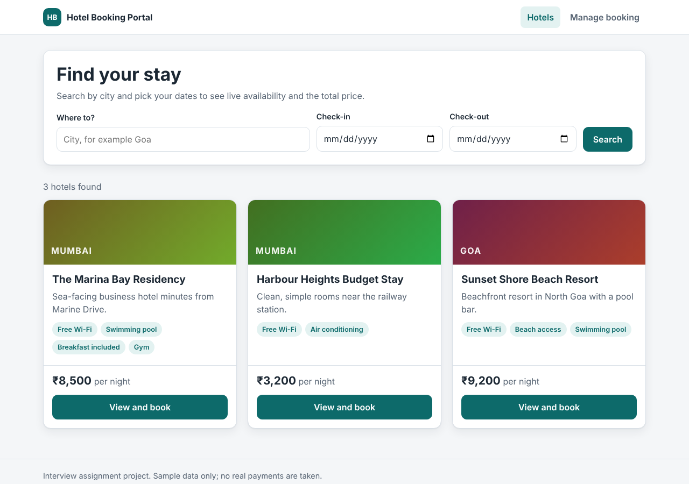
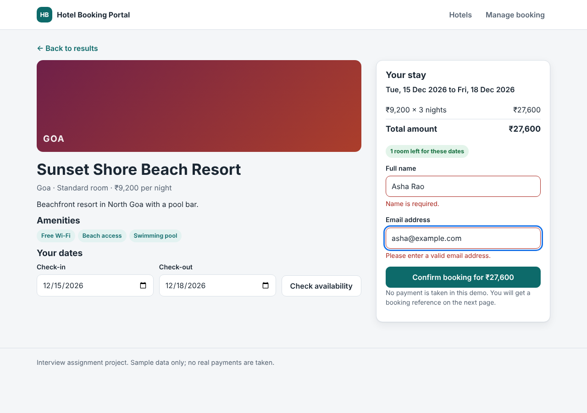
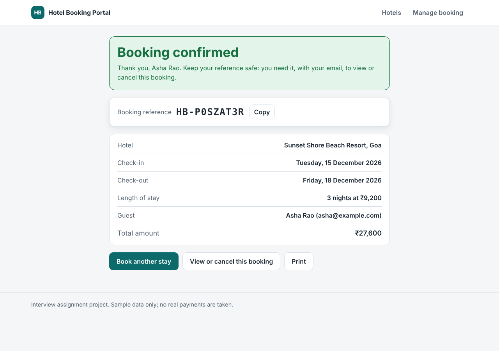
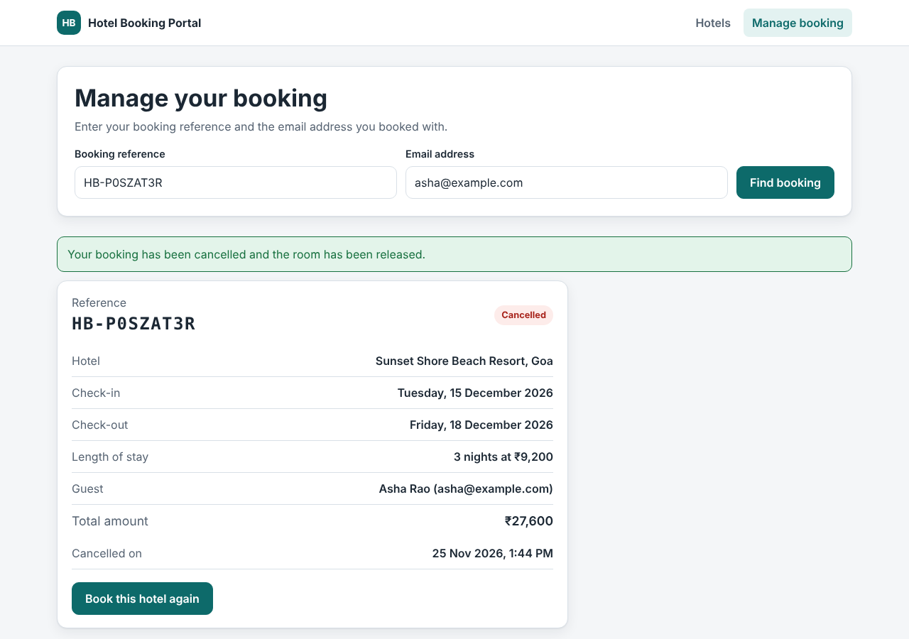
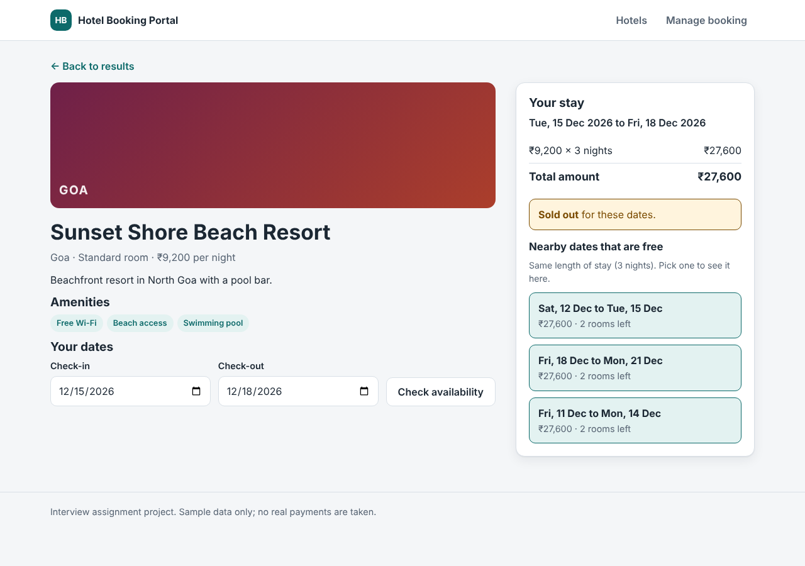

# Hotel Booking Portal

A small full-stack hotel booking app: browse and search hotels, pick dates, see the total price, book a room, then look up and cancel a booking using its reference and email.

**Stack:** Java 21 + Spring Boot 3.5 (REST API), Angular 22, MySQL 8, Flyway migrations.

## Screenshots







Demo video: [LINK, or delete this line]

## Prerequisites

- Java 21 JDK
- Node.js 22 or newer (with npm)
- Docker Desktop (for MySQL). Without Docker, install MySQL 8 yourself; see below.
- Git
- Maven wrapper files (`mvnw`, `mvnw.cmd`, `.mvn/`) in `backend/` (see "Maven wrapper" below)

## Run it locally

1. Clone and enter the project:
   ```
   git clone [YOUR REPO URL]
   cd hotel-booking-portal
   ```
2. Create your environment file and choose passwords (letters and digits only):
   ```
   cp .env.example .env        # Windows: copy .env.example .env
   ```
3. Start MySQL (Flyway creates the schema and 7 sample hotels when the backend starts):
   ```
   docker compose up -d
   ```
4. Start the backend (new terminal):
   ```
   cd backend
   ./mvnw spring-boot:run      # Windows: .\mvnw.cmd spring-boot:run
   ```
   API at http://localhost:8080 (try http://localhost:8080/api/hotels).
5. Start the frontend (new terminal):
   ```
   cd frontend
   npm install
   npm start
   ```
   Open http://localhost:4200.

### Maven wrapper

The wrapper files come from https://start.spring.io (Maven, Java 21, Spring Boot 3.5.x, Group com.example, Artifact hotel-booking). Generate a project there, then copy its `mvnw`, `mvnw.cmd` and `.mvn` folder into `backend/`. Alternatively install Maven 3.9+ and use `mvn` instead of `./mvnw`.

### Without Docker

Create the database and user in MySQL, using the same values as `.env`:

```sql
CREATE DATABASE hotel_booking CHARACTER SET utf8mb4 COLLATE utf8mb4_unicode_ci;
CREATE USER 'hotel_user'@'%' IDENTIFIED BY 'your_password';
GRANT ALL PRIVILEGES ON hotel_booking.* TO 'hotel_user'@'%';
```

## Database scripts and sample data

- `backend/src/main/resources/db/migration/V1__schema.sql`: tables and constraints
- `backend/src/main/resources/db/migration/V2__seed_hotels.sql`: 7 sample hotels
- Nightly room inventory (next 365 days) is generated at startup by `InventoryInitializer`.
- Reset the database: `docker compose down -v`, then `docker compose up -d`.

## Run the tests

```
cd backend
./mvnw test
```

Tests use an in-memory H2 database; MySQL is not needed. They cover price and nights, date validation, overlapping stays, capacity limits, cancellation releasing rooms, the surprise feature, error responses, and concurrent bookings for the last rooms.

## Secrets

No credentials are committed. Passwords live in `.env` (git-ignored); `.env.example` has placeholders.

## Assumptions

- One room category per hotel; a booking is for one room.
- A stay covers the nights from check-in up to, but not including, check-out. A guest leaving on a date and a guest arriving the same date do not conflict.
- Prices are in Indian rupees. Dates use the server's time zone. Check-in may be today; stays are at most 30 nights; bookings open 365 days ahead.
- A booking can be cancelled until its check-in date. No payment, login or admin screen (out of scope).
- Email is the lightweight proof of ownership for looking up a booking (no verification email is sent).

## Surprise feature: nearby free dates

When the chosen dates are sold out, the hotel page suggests up to 3 stays of the same length, within 14 days either side, that are free, closest first. One click re-quotes that stay. See DESIGN.md.

## Time spent and unfinished items

- Approximate time spent: **[N] hours** (suggested effort: 12 to 16).
- Unfinished or simplified: **[LIST HONESTLY, e.g. no frontend unit tests; no pagination; no email sending]**.

## AI assistance disclosure

I used Claude (an AI assistant) to **[DESCRIBE: e.g. generate the first version of the code and tests, which I then ran, read and adjusted]**. I understand the code and can explain it.
